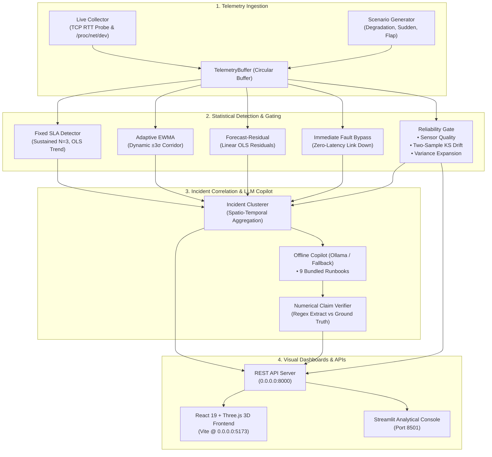

# PRECURSOR

> **Reliability-Gated Early Warning & Root-Cause Copilot for Critical Network Infrastructure**

[](./flake.nix)
[](./tests/)
[](./requirements.txt)
[](./package.json)
[](./src/)

---

## ⚡ Overview

**PRECURSOR** is an early warning system and diagnostic copilot for high-stakes network environments. It bridges real-time Linux telemetry capture with statistical anomaly detectors, an evidence-based reliability gate, spatio-temporal incident correlation, and an offline LLM copilot that verifies its own assertions against ground-truth telemetry.

Unlike traditional monitoring tools that generate false alarm fatigue or black-box ML models that hallucinate failure metrics, PRECURSOR enforces:
1. **Multi-Horizon Early Warnings**: Forecasts metric breaches at **+5m, +15m, and +30m** horizons before SLAs drop.
2. **Tri-State Reliability Gate**: Dynamically evaluates sensor health, Kolmogorov-Smirnov distribution drift, and residual variance expansion to gate predictions (`PREDICT`, `DEGRADED`, `ABSTAIN`).
3. **Zero-Latency Immediate Invariant**: Hard physical faults (e.g., link-down, 100% loss) bypass model gates immediately.
4. **Audited AI Copilot**: Grounded in 9 bundled operational runbooks with strict JSON output, structured hypotheses, testable operational assumptions (`VALIDATED`, `VIOLATED`, `UNTESTABLE`), and numerical claim verification ($\pm 10\%$ tolerance).
5. **Dual Operation Mode**: Seamless switching between live Linux socket/interface polling and reproducible synthetic scenarios.
6. **100% Full Feature Parity**: Deep packet capture forensics, custom telemetry injection presets, simulation timeline fast-forwarding, dynamic SLA threshold overrides, and an offline runbook library browser.

---

## 🏗️ Architecture



---

## 🔬 Core Components

### 1. Multi-Horizon Statistical Detectors ([`precursor/detectors/`](./precursor/detectors/))
* **Fixed SLA Detector** ([`fixed_sla.py`](./precursor/detectors/fixed_sla.py)): Checks sustained threshold breaches ($N=3$ consecutive samples) and projects linear OLS trends across horizons ($h \in [5, 15, 30]$ min).
* **Adaptive EWMA Detector** ([`ewma.py`](./precursor/detectors/ewma.py)): Maintains $\mu_t = \alpha x_t + (1-\alpha)\mu_{t-1}$ ($\alpha = 0.2$) with rolling variance and dynamic upper limit $\mu_t + 3\sigma_t$. Projects EWMA slope across the prediction horizon.
* **Forecast-Residual Detector** ([`forecast_residual.py`](./precursor/detectors/forecast_residual.py)): Evaluates normalized OLS residuals $R_{\text{norm}} = |y - \hat{y}| / \text{RMSE}$ against a $2.5\times$ threshold factor and detects $> 3\sigma$ baseline drift.
* **Immediate Fault Detector** ([`immediate.py`](./precursor/detectors/immediate.py)): Detects hard physical cuts (`link_state == 0.0` or `packet_loss_pct >= 99%`) with zero latency.

### 2. Tri-State Reliability Gate ([`precursor/gate/`](./precursor/gate/))
Regulates predictive alerts according to input data trustworthiness:
* **`PREDICT`**: Normal telemetry. All predictive models emit proactive alerts.
* **`DEGRADED`**: Sensor degradation ($20\%\text{--}50\%$), two-sample Kolmogorov-Smirnov drift ($D_{KS} > 0.65, p < 0.01$), or residual variance expansion ($> 3.5\times$). Projections continue with confidence penalties.
* **`ABSTAIN`**: Severe sensor corruption ($> 50\%$ missing/stale/invalid). Predictive warnings are suppressed to prevent false alarms.
* **Safety Invariant**: `immediate_alerts_active = True` in all states.

### 3. Grounded Copilot & Assumption Auditing ([`precursor/copilot/`](./precursor/copilot/))
* **Local Offline Execution**: Connects to local Ollama (`llama3.2:1b`) with automated deterministic fallback.
* **Strict JSON Schema (`CopilotStrictJSON`)**: Enforces structured synthesis comprising natural language summary, hypotheses list, testable operational assumptions, copyable diagnostic commands, and rollback guidance.
* **Assumption & Claim Verifier** ([`claim_verifier.py`](./precursor/copilot/claim_verifier.py)): Evaluates operational assumptions against ground-truth telemetry with mathematical predicates (`metric_id`, `operator`, `expected_value`) to yield `VALIDATED`, `VIOLATED`, or `UNTESTABLE` statuses, plus numerical claim tolerance auditing ($\pm 10\%$).
* **9 Bundled Operational Runbooks**: Full Markdown procedures covering latency/jitter bufferbloat, interface degradation, packet loss, routing flap, congestion, connectivity blackholes, sensor corruption, MTU fragmentation, and post-incident gate recovery.

### 4. Live Linux Network Telemetry ([`precursor/telemetry/live_collector.py`](./precursor/telemetry/live_collector.py))
Measures active network interface parameters:
* **TCP Connect RTT**: Socket latency measurement in milliseconds.
* **Jitter**: Rolling delta of consecutive RTT probes.
* **Packet Loss**: Connection reachability and timeout ratios.
* **Interface Counters**: Reads `/proc/net/dev` for `throughput_mbps`, `drops_in`, and interface carrier status.

### 5. Forensics, Dynamic Ingestion & Runtime Control
* **Granular Packet Forensics** ([`PacketForensicsTab.tsx`](./src/features/incidents/components/PacketForensicsTab.tsx)): Dissects sampled incident packets (TCP/UDP/ICMP/IP) with protocol filtering, raw layer headers, and JSON export.
* **Custom Telemetry Ingest** ([`CustomIngestModal.tsx`](./src/features/telemetry/components/CustomIngestModal.tsx)): Allows operators to inject custom telemetry points with one-click anomaly presets (*Severe Latency Spike*, *Packet Loss Burst*, *Jitter Storm*, *Degraded Sensor*).
* **Simulation Fast-Forward**: Advances time by $+15\text{s}, +1\text{m}, +5\text{m}, +15\text{m}$ to inspect dynamic horizon transitions.
* **Detection & Gate Threshold Overrides** ([`ThresholdsSettingsSection.tsx`](./src/features/settings/components/ThresholdsSettingsSection.tsx)): Allows runtime tuning of SLA limits (RTT, Loss, Jitter) and Gate KS drift significance ($\alpha$).
* **Runbook Library Browser** ([`RunbookLibrarySection.tsx`](./src/features/copilot/components/RunbookLibrarySection.tsx)): Air-gapped visual catalog of all 9 operational runbooks with tag search and copyable diagnostic commands.

---

## 🚀 Quickstart & Setup

The project uses [Nix flakes](./flake.nix) to ensure 100% reproducible development and testing environments.

### 1. Enter the Nix DevShell
```bash
# Clone the repository
git clone https://github.com/Reputable2772/dsce-hackmanx.git
cd dsce-hackmanx

# Enter the devShell (loads Python 3, Node 22, iputils, iproute2, system libs)
nix develop
```

### 2. Environment Setup
```bash
# Initialize Python virtual environment
python -m venv .venv
source .venv/bin/activate
pip install -r requirements.txt

# Install Frontend dependencies
npm install
```

### 3. Run the Full Test Suite
```bash
# Execute all 24 unit, integration, live mode, and project-wide E2E tests
pytest
```

---

## 🖥️ Running the Application

### Option A: Complete Web Stack (Backend + 3D Frontend)

1. **Start the REST API Server**:
   ```bash
   nix develop --command bash -c "source .venv/bin/activate && python precursor/server.py"
   # Running on http://0.0.0.0:8000
   ```

2. **Start the React / Three.js 3D Frontend**:
   ```bash
   nix develop --command npm run dev
   # Vite development server running on http://0.0.0.0:5173
   ```

### Option B: Streamlit Analytical Console

```bash
nix develop --command bash -c "source .venv/bin/activate && streamlit run dashboard/app.py"
# Analytical dashboard running on http://0.0.0.0:8501
```

---

## 📡 REST API Reference

The backend exposes an asynchronous REST API on port `8000`:

| Method | Endpoint | Description |
| :--- | :--- | :--- |
| `GET` | `/health` | System health, current simulation/live time, active mode |
| `GET` | `/api/mode` | Returns active operation mode (`synthetic` or `live`) |
| `POST` | `/api/mode` | Switch mode: `{"mode": "live", "target_host": "1.1.1.1"}` |
| `POST` | `/api/telemetry/ingest` | Ingest external batch of `TelemetryPoint` records with node auto-discovery |
| `GET` | `/api/snapshot` | Fetch latest snapshot (gate decision, detectors, incidents, claims) |
| `POST` | `/api/step` | Advance timeline by +5 seconds |
| `POST` | `/api/fast_forward` | Advance timeline by $N$ seconds: `{"seconds": 60.0}` |
| `POST` | `/api/reset` | Reset scenario: `{"scenario": "sudden_failure", "seed": 42}` |
| `GET` | `/api/systems` | Hardware inventory and peer health overview |
| `GET` | `/api/topology/systems` | Dynamic 3D network topology graph nodes & links |
| `GET` | `/api/incidents/history` | Paginated historical incidents list from SQLite |
| `GET` | `/api/incidents/{id}` | Full incident envelope with grounded Copilot guidance |
| `GET` | `/api/incidents/{id}/packets` | Granular forensic packet sampling (TCP/UDP/ICMP/IP/ETH) |
| `POST` | `/api/incidents/{id}/status` | Update incident lifecycle status (`OPEN`, `INVESTIGATING`, `RESOLVED`) |
| `POST` | `/api/copilot/query` | User-triggered Copilot query with instant overview and deep LLM hypothesis |
| `GET` | `/api/runbooks` | Catalog of all 9 operational network runbooks |
| `GET` | `/api/runbooks/{id}` | Fetch individual runbook Markdown procedure |
| `GET` | `/api/config` | Read runtime SLA and reliability gate configuration |
| `PATCH` | `/api/config` | Update dynamic SLA thresholds and Gate alpha level |
| `GET` | `/api/evaluation` | Counterfactual paired benchmark evaluation (`gate_on` vs `gate_off`) |
| `GET` | `/api/export/csv` | Download active telemetry stream as RFC 4180 CSV |
| `GET` | `/api/export/json` | Download structured nested run archive JSON |

---

## 🧪 Testing Suite Matrix

| Module | Count | Status | Description |
| :--- | :---: | :---: | :--- |
| [`test_e2e_flow.py`](./tests/test_e2e_flow.py) | 1 | **PASSED** | End-to-end: Live capture $\to$ Buffer $\to$ Detectors $\to$ Gate $\to$ Incident $\to$ LLM $\to$ Claim audit $\to$ Actions |
| [`test_precursor.py`](./tests/test_precursor.py) | 8 | **PASSED** | Ring buffer query, quality checks, SLA breaches, EWMA $\pm 3\sigma$, KS drift, and gate transitions |
| [`test_storage_export.py`](./tests/test_storage_export.py) | 6 | **PASSED** | UTC ISO 8601 timestamps, CSV fidelity, JSON run archives, local persistence, scenario reproducibility |
| [`test_live_mode.py`](./tests/test_live_mode.py) | 3 | **PASSED** | Live TCP connect RTT, Linux `/proc/net/dev` interface counters, engine live step, REST ingestion |
| [`test_integration.py`](./tests/test_integration.py) | 6 | **PASSED** | Multi-horizon incident clustering, paired counterfactual evaluation, REST engine pipeline |
| [`test_server_endpoints.py`](./tests/test_server_endpoints.py) | 13 | **PASSED** | Comprehensive REST endpoint integration, lifecycle, simulation controls, copilot queries |
| [`test_history_and_incidents.py`](./tests/test_history_and_incidents.py) | 6 | **PASSED** | SQLite WAL persistence, deterministic IDs, claim verification, notifications, CSV exports |
| [`test_incident_db_and_topology.py`](./tests/test_incident_db_and_topology.py) | 3 | **PASSED** | Packet forensics, 3D topology graph schema, REST system endpoints |
| [`test_systems_api.py`](./tests/test_systems_api.py) | 6 | **PASSED** | Peer registration, live health probing, dynamic system inventory CRUD |
| [`test_simulation_scenarios.py`](./tests/test_simulation_scenarios.py) | 5 | **PASSED** | Bufferbloat, link cut immediate alert, sensor drift KS test, dual-stage Copilot, custom telemetry injection |
| [`test_simulation_advanced_situations.py`](./tests/test_simulation_advanced_situations.py) | 5 | **PASSED** | Scenario transitions across all modes, multi-node telemetry discovery, packet fidelity, counterfactual API, 404 validation |
| [`test_parity_endpoints.py`](./tests/test_parity_endpoints.py) | 4 | **PASSED** | Simulation fast-forward, SLA & Gate threshold overrides, custom telemetry ingestion, runbooks list |
| **Total** | **66** | **100%** | All 12 test suites passing |

---

## 👥 Multi-Agent Engineering Collaboration

This project was developed through active pair-programming and asynchronous coordination between autonomous agents:
* **Callsign C (Core / Intelligence)**: Telemetry buffer, statistical detectors, reliability gate, offline LLM copilot, numerical claim verification, and REST API server.
* **Callsign P (Presentation / Platform)**: React 19 / Three.js 3D world canvas, Streamlit analytical dashboard, time-travel controls, and frontend interactive telemetry charts.
